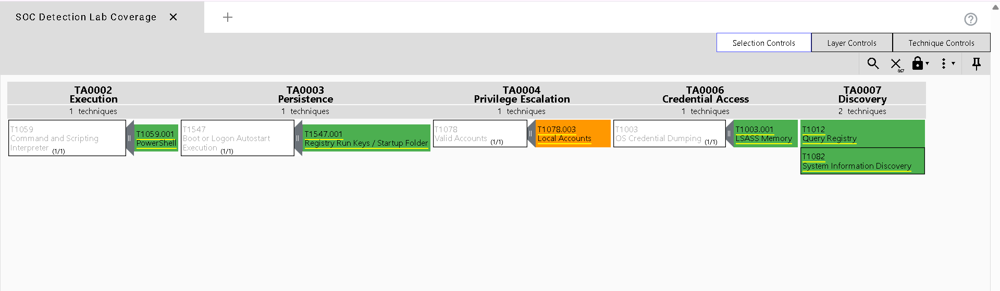

# MITRE ATT&CK SOC Detection Lab

> A home lab project simulating five MITRE ATT&CK tactics using Atomic Red Team
> on a Windows 10 VM, with custom Elastic SIEM detection rules validated against
> real adversary simulations.

## 🎯 Project Goals

- Demonstrate detection engineering skills using industry-standard tooling
- Map simulated attacks to the MITRE ATT&CK Enterprise framework
- Write, test, and document custom SIEM detection rules
- Produce artefacts suitable for a SOC analyst or detection engineer portfolio
  
## 🛠 Tech Stack
| Component | Tool |
|--|--|
| SIEM | Elastic Stack 8.x (Elasticsearch + Kibana) |
| Log Shipping | Elastic Agent + Fleet Server |
| Endpoint Telemetry | Sysmon (SwiftOnSecurity config) |
| Attack Simulation | Atomic Red Team (Invoke-AtomicRedTeam) |
| Infrastructure | VirtualBox, Kali Linux 2024.x, Windows 10 |

## 🔴 Simulated Techniques
| MITRE ID | Technique | Tactic | Alert Triggered |
|--|--|--|--|
| T1059.001 | PowerShell Encoded Commands | Execution | ✅ |
| T1547.001 | Registry Run Key Persistence | Persistence | ✅ |
| T1078 | New Local Admin Account | Privilege Escalation | ✅ |
| T1562.001 | Disable Windows Defender | Defense Evasion | ✅ |
| T1003.001 | LSASS Memory Dump | Credential Access | ✅ |

## 📁 Repository Contents

- `detection_rules/` — Kibana NDJSON export + per-rule documentation
- `navigator/` — ATT&CK Navigator JSON layer (import at attack.mitre.org/navigator)
- `atomic_tests/` — PowerShell scripts and test result documentation
- `docs/` — Full setup guide and architecture
  
## 🚀 Quick Start

See [docs/lab_setup.md](docs/lab_setup.md) for the full environment setup guide.
To run all simulations (isolated lab only!):
```powershell
.\atomic_tests\run_all_tests.ps1
```

To import detection rules into Kibana:
**Security → Rules → Import** → select `detection_rules/elastic_rules.ndjson`

## 📊 ATT&CK Coverage
Import `navigator/attack_layer.json` at the [ATT&CK Navigator](https://mitre-attack)
to view coverage.

## ⚠ Disclaimer
This project is for educational purposes in an isolated lab environment only.
Never run attack simulations on production systems or networks you do not own.
