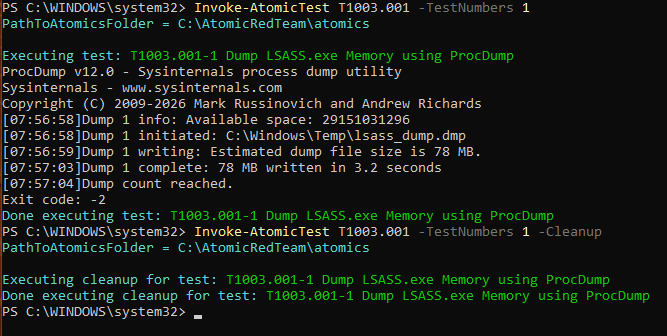
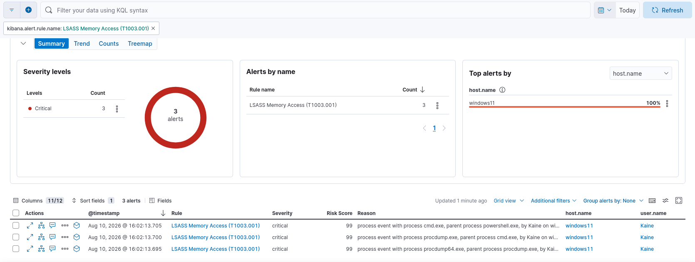

# Detection Rule: LSASS Memory Dump via ProcDump

| Field | Value |
|---|---|
| **MITRE ID** | T1003.001 |
| **Tactic** | Credential Access |
| **Severity** | Critical |
| **Risk Score** | 99 |
| **Platform** | Windows |
| **Data Sources** | Sysmon Event ID 1 (Process Create), Sysmon Event ID 10 (Process Access) |

## Description

Detects attempts to dump the memory of the Local Security Authority Subsystem Service
(`lsass.exe`) using ProcDump or similar tools. LSASS holds credentials (NTLM hashes,
Kerberos tickets, and in some configurations plaintext passwords) for all currently
logged-on users. Dumping LSASS memory is one of the most impactful post-exploitation
steps an attacker can take, enabling lateral movement via pass-the-hash or
pass-the-ticket without needing to crack credentials offline.

## Detection Logic (ES|QL)

```esql
FROM logs-* METADATA _id, _version, _index
| WHERE winlog.event_id == "1"
  AND TO_LOWER(process.command_line) RLIKE ".*lsass.*"
  AND TO_LOWER(process.command_line) RLIKE ".*procdump.*"
| KEEP _id, _version, _index, @timestamp, host.name, user.name, process.name,
       process.parent.name, process.command_line
| SORT @timestamp DESC
```

## Validation

Tested with Atomic Red Team: `Invoke-AtomicTest T1003.001 -TestNumbers 1`

**Test name:** Dump LSASS.exe Memory using ProcDump (T1003.001-1)



**What the test does:** Downloads ProcDump from Sysinternals (prerequisite step) and executes `procdump.exe -accepteula -ma lsass.exe C:\Windows\Temp\lsass_dump.dmp` to write a full LSASS memory dump to disk. The dump file contains NTLM hashes and potentially plaintext credentials for all logged-on users, extractable offline with Mimikatz.

**Result:** 78MB LSASS dump file written successfully. Three Sysmon Event ID 1 logs captured. ✅



**Lessons Learned:**

1. **Multi-hop invocation chain confirmed** — A single `Invoke-AtomicTest` call produced
   a verified four-hop parent-child process chain occurring within ~320ms:
   `powershell.exe → cmd.exe → procdump.exe → procdump64.exe`
   This confirmed ProcDump v12.0 self-relaunches as its 64-bit variant when running on a
   64-bit OS, rather than requiring manual selection of the correct binary.

2. **Rule design — command-line over process name** — Initial rule filtered on
   `process.name: "procdump64.exe"` which missed the `cmd.exe` invocation event where
   ProcDump is embedded as a quoted command-line argument. Revised to use `RLIKE` substring
   matching on `process.command_line` for both `lsass` and `procdump`, making the rule
   launcher-agnostic and catching all four hops of the chain independently.

3. **`LIKE` vs `RLIKE` in ES|QL** — `LIKE` with `%pattern%` wildcards did not work in
   this environment. `RLIKE` with `.*pattern.*` regex syntax was required.

4. **METADATA requirement** — ES|QL detection rules require `METADATA _id, _version, _index`
   declared after the `FROM` clause, with all three fields explicitly returned in `KEEP`,
   otherwise Kibana rejects the query as an invalid detection rule.

## Response Steps

1. **Isolate the host immediately** — LSASS dump = credentials are compromised; assume
   all credentials cached on this host are stolen
2. Delete the dump file if still present: `Remove-Item C:\Windows\Temp\lsass_dump.dmp -Force`
3. Force password reset for all accounts that have logged into this host
   (check via `winlog.event_id: 4624` for the past 90 days)
4. Check for Mimikatz or credential parsing tools executed after the dump
   via Sysmon Event ID 1 in the same timeframe
5. Review network connections (`winlog.event_id: 3`) from the host in the 30 minutes
   following the dump — lateral movement often occurs immediately after credential extraction
6. Rotate all Kerberos tickets (krbtgt password reset x2) if domain-joined
