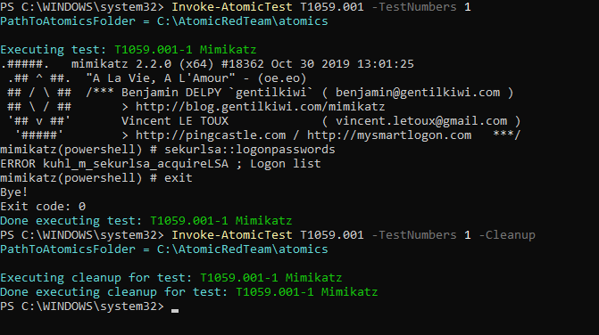
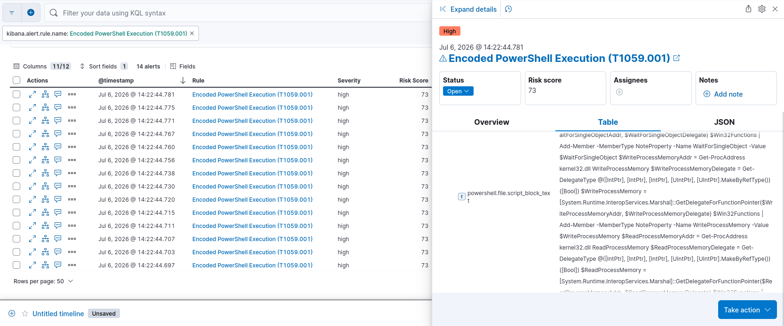

# Detection Rule: Malicious PowerShell Script Block

| Field | Value |
|---|---|
| **MITRE ID** | T1059.001 |
| **Tactic** | Execution |
| **Severity** | High |
| **Risk Score** | 73 |
| **Platform** | Windows |
| **Data Sources** | PowerShell Script Block Logging (Event ID 4104) |

## Description

Detects PowerShell script blocks containing combinations of Windows API calls commonly
associated with in-memory code injection, reflective DLL loading, and process
manipulation. Attackers use PowerShell to call low-level Win32 APIs directly via
P/Invoke or reflection, bypassing the need to drop files to disk, defeating
traditional signature-based detection.

## Detection Logic (KQL)

```kql
host.os.type: "windows" and
powershell.file.script_block_text: (
  (VirtualAlloc or VirtualAllocEx or VirtualProtect or LdrLoadDll or
   LoadLibrary or LoadLibraryA or LoadLibraryEx or GetProcAddress or
   OpenProcess or OpenProcessToken or AdjustTokenPrivileges)
  and
  (WriteProcessMemory or CreateRemoteThread or NtCreateThreadEx or
   CreateThread or QueueUserAPC or SuspendThread or ResumeThread or
   GetDelegateForFunctionPointer)
) and not
file.directory: (
  "C:\\ProgramData\\Microsoft\\Windows Defender Advanced Threat Protection\\SenseCM" or
  "C:\\ProgramData\\Microsoft\\Windows Defender Advanced Threat Protection\\Downloads"
)
```
The rule pairs two categories of API calls that must both appear in the same script
block to fire:

**Memory allocation / library loading APIs** (stage 1 — preparing injection):
`VirtualAlloc`, `VirtualAllocEx`, `VirtualProtect`, `LdrLoadDll`, `LoadLibrary`,
`LoadLibraryA`, `LoadLibraryEx`, `GetProcAddress`, `OpenProcess`,
`OpenProcessToken`, `AdjustTokenPrivileges`

**Execution / thread injection APIs** (stage 2 — triggering execution):
`WriteProcessMemory`, `CreateRemoteThread`, `NtCreateThreadEx`, `CreateThread`,
`QueueUserAPC`, `SuspendThread`, `ResumeThread`, `GetDelegateForFunctionPointer`

This pattern directly covers the Mimikatz reflective loader technique observed during
Atomic Red Team test T1059.001-1, where PowerShell used reflection APIs to load and
execute Mimikatz entirely in-memory without writing the binary to disk in a detectable form.

## Validation

Tested with Atomic Red Team: `Invoke-AtomicTest T1059.001 -TestNumbers 1`

**Test name:** Mimikatz (T1059.001-1)



**What the test does:** Downloads a PowerShell-wrapped version of Mimikatz and executes
`sekurlsa::logonpasswords` entirely in-memory via PowerShell reflection APIs, without
dropping a traditional Mimikatz `.exe` to disk in a detectable location.

**Result:** Since PowerShell splits execution into multiple script blocks (outer script, nested functions, dynamically-defined blocks), each generating its own Event ID 4104 entry, multiple entries were captured with `winlog.event_id: 4104`. Script block content is visible in `powershell.file.script_block_text`, containing a Mimikatz invocation. ✅



## Response Steps

1. Retrieve the full script block content from `winlog.event_data.ScriptBlockText` across
   all related Event ID 4104 entries (filter by `process.entity_id` or PID and timestamp
   to reconstruct the full execution)
2. Identify which injection API combination was used — `CreateRemoteThread` vs
   `QueueUserAPC` vs `NtCreateThreadEx` each indicate different injection technique
   variants worth noting in your incident timeline
3. Check Sysmon Event ID 1 (same PID, slightly earlier timestamp) for the PowerShell
   process launch — review `process.parent.name` and `process.parent.command_line`
   to identify the initial access vector that spawned PowerShell
4. Check Sysmon Event ID 10 (Process Access) from the same PowerShell process — if it
   accessed `lsass.exe`, this is now a combined T1059.001 + T1003.001 incident
5. Check Sysmon Event ID 3 (Network Connection) — if the PowerShell process made
   outbound connections after the script block executed, assume C2 communication
6. Isolate the host if any of steps 3-5 are confirmed positive
