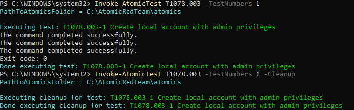
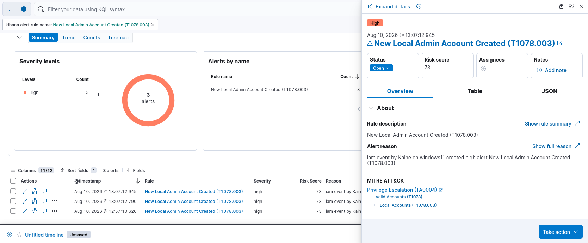

# Detection Rule: New Local Account Created

| Field | Value |
|---|---|
| **MITRE ID** | T1078.003 |
| **Tactic** | Privilege Escalation |
| **Severity** | High |
| **Risk Score** | 73 |
| **Platform** | Windows |
| **Data Sources** | Windows Security Event ID 4720, 4732 |

## Description

Detects the creation of a new local user account followed by its addition to a privileged
group (Administrators, SID `S-1-5-32-544`). Attackers create local admin accounts to
maintain persistent privileged access, survive password resets on existing accounts,
and establish a fallback entry point independent of domain credentials.

## Detection Logic (EQL)

```eql
sequence by winlog.event_data.SubjectUserName with maxspan=60s
  [iam where event.code == "4720"]
  [iam where event.code == "4732" and winlog.event_data.TargetSid == "S-1-5-32-544"]
```

## Validation

Tested with Atomic Red Team: `Invoke-AtomicTest T1078.003 -TestNumbers 1`

**Test name:** Create local account with admin privileges (T1078.003-1)



**What the test does:** Simulates an adversary creating a new local user account and elevating it to administrator level to establish persistence or facilitate privilege escalation.

**Result:** Event ID 4720 (account created) and Event ID 4732 (added to group) captured. ✅



**Lessons Learned:**
- Initial rule incorrectly mapped to T1078 (Valid Accounts — using existing credentials)
  rather than T1136.001 (Create Account — Local). The correct MITRE technique for
  *creating* a new account is T1136.001, while T1078 covers *abuse of existing* accounts.
  Detection strategy DET0447 from `attack.mitre.org/detectionstrategies/DET0447/`
  confirmed this mapping.
- EQL category `authentication` was incorrect for 4720/4732 events; correct category
  is `iam` (Identity and Access Management), or use `any` for environment-agnostic matching.
- Test produced `TargetSid: S-1-5-32-545` (Users group), not `S-1-5-32-544` (Administrators).
  Rule retains the Administrators SID condition for production accuracy, with a broader
  supplementary query for lab validation.

## False Positive Guidance

- IT helpdesk creating new user accounts via standard provisioning tools
- Automated onboarding scripts (scope by `SubjectUserName` to exclude known service accounts)
- Software installers creating service accounts during setup

## Response Steps

1. Identify the actor who created the account via `winlog.event_data.SubjectUserName`
2. Confirm whether this account creation was authorized via change management or helpdesk ticket
3. Check `winlog.event_data.TargetUserName` for the new account name — search for subsequent logon events (4624) using this account to determine if it has been used
4. Review the parent process of the `net.exe` or `New-LocalUser` command via Sysmon Event ID 1
5. If unauthorized, disable the account immediately: `net user <username> /active:no`
6. Audit all local group memberships: `Get-LocalGroupMember -Group "Administrators"`
