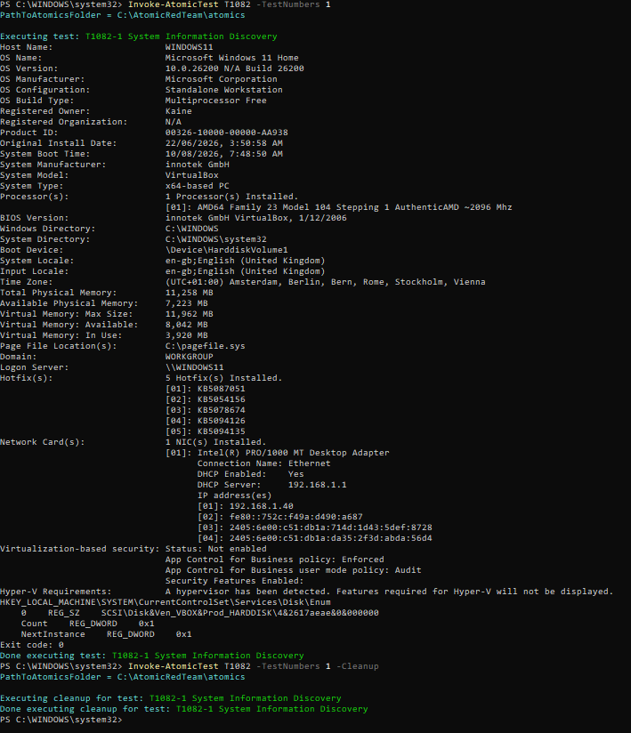
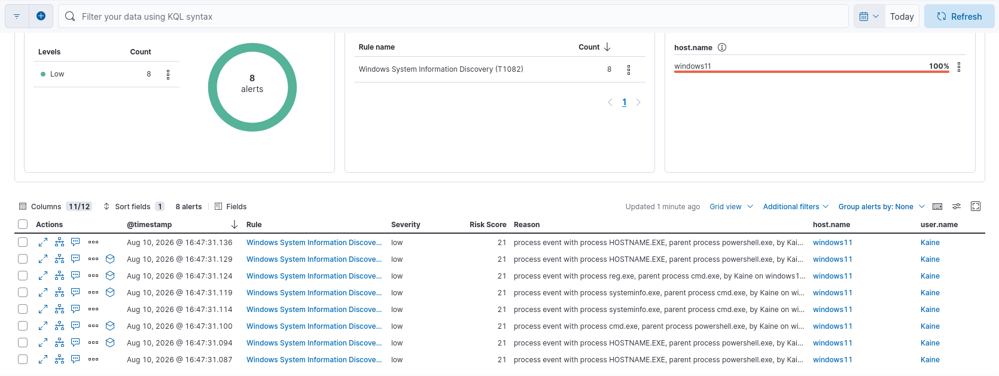

# Detection Rule: System Information Discovery

| Field | Value |
|---|---|
| **MITRE ID** | T1082 |
| **Tactic** | Discovery |
| **Severity** | Low |
| **Risk Score** | 21 |
| **Platform** | Windows |
| **Data Sources** | Sysmon Event ID 1 (Process Create), Windows Security Event ID 4688 |

## Description

Detects execution of system information discovery tools commonly used by attackers
during the reconnaissance phase to enumerate the target environment. This includes
direct execution of `systeminfo.exe`, `hostname.exe`, shell-chained discovery commands
via `cmd.exe`, and WMI-based system queries. Adversaries use this information to
identify OS version, installed patches, hardware configuration, and domain membership
to plan privilege escalation and lateral movement.

## Detection Logic (KQL)

```kql
host.os.type: "windows" and event.type: "start" and ( 
( 
   process.name: "cmd.exe" and 
   process.args: *systeminfo* and 
   not process.parent.executable: ( 
      *\\Users\\*\\AppData\\Local\\Keybase\\upd.exe or 
      *\\Users\\*\\python*.exe ) 
) or 
   process.name: ("systeminfo.exe" or "hostname.exe" or "HOSTNAME.EXE") 
or ( 
   process.name: "reg.exe" and 
   process.args: "query" and 
   process.command_line: ( 
      *CurrentControlSet\\Services* or 
      *CurrentControlSet\\Control* ) 
) 
) 
and not process.parent.executable: ( 
   "*\\Program Files\\*" or 
   "*\\Program Files (x86)\\*" or 
   "*\\ProgramData\\*" ) 
```

## Validation

Tested with Atomic Red Team: `Invoke-AtomicTest T1082 -TestNumbers 1`

**Test name:** System Information Discovery (T1082-1)



**What the test does:** Executes a chained discovery command via `cmd.exe /c`: first runs `systeminfo` (enumerates OS version, hotfixes, memory, network adapters, and domain membership), then immediately runs `reg query HKLM\SYSTEM\CurrentControlSet\Services\Disk\Enum` (enumerates attached disk devices, commonly used for VM/sandbox detection). Also separately spawns `HOSTNAME.EXE` to collect the machine name.

**Logs captured:**

| Event ID | Process | Command Line |
|---|---|---|
| 1 + 4688 | `HOSTNAME.EXE` | `C:\WINDOWS\system32\HOSTNAME.EXE` |
| 1 + 4688 | `whoami.exe` | `C:\WINDOWS\system32\whoami.exe` |
| 1 + 4688 | `cmd.exe` | `"cmd.exe" /c systeminfo & reg query HKLM\SYSTEM\CurrentControlSet\Services\Disk\Enum` |
| 1 + 4688 | `systeminfo.exe` | `systeminfo` |
| 1 | `reg.exe` | `reg query HKLM\SYSTEM\CurrentControlSet\Services\Disk\Enum` |

**Result:** `systeminfo.exe`, `hostname.exe`, and `cmd.exe /c systeminfo` branches all
detected. Alert fired successfully. ✅



**Lessons Learned:**

1. **`reg.exe` maps to T1012, not T1082** — The `reg query` execution observed during this
   test technically maps to T1012 (Query Registry), a separate ATT&CK technique. It is
   included in this rule's scope because the Atomic test chains it with `systeminfo` in a
   single `cmd.exe /c` invocation, but a dedicated T1012 rule was also created for
   standalone `reg.exe query` detection.

2. **`whoami.exe` captured but not covered** — `whoami.exe` execution maps to T1033
   (System Owner/User Discovery), not T1082. It was intentionally excluded from this rule
   to maintain technique-accurate scoping.

## False Positive Guidance

- IT inventory and asset management tools running `systeminfo` on schedule (very common —
  baseline by `process.parent.executable` to known management agent paths)
- Logon scripts that run `hostname` for environment detection
- `systeminfo.exe` and `hostname.exe` have no argument-level filtering by design — any
  execution is flagged. This is intentionally sensitive; tune by parent process exclusion
  rather than by command-line pattern for these two binaries

## Response Steps

1. Determine if the discovery was initiated by a known user or an automated process
   via `user.name` and `process.parent.executable`
2. Check for command chaining (multiple discovery tools in rapid succession from the same
   parent process) — this significantly elevates confidence of adversary reconnaissance
3. Correlate with earlier suspicious events: did a suspicious login (4624), new process
   (Event ID 1), or PowerShell execution precede this discovery activity?
4. Check `winlog.event_id: 3` (Sysmon Network Connection) from the same process —
   exfiltrating discovery output to a remote host is a key escalation indicator
5. If discovery is confirmed malicious, treat as an active intrusion in progress and
   escalate to incident response immediately
