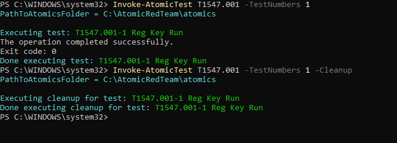
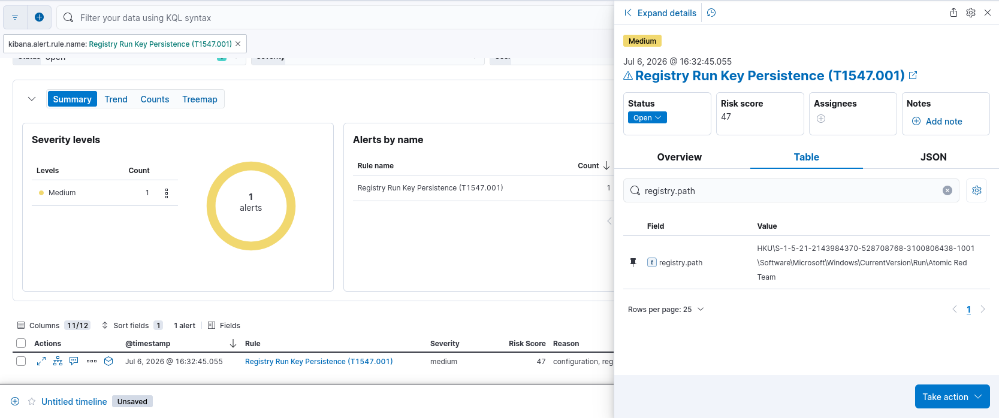

# Detection Rule: Registry Run Key Persistence

| Field | Value |
|---|---|
| **MITRE ID** | T1547.001 |
| **Tactic** | Persistence |
| **Severity** | Medium |
| **Risk Score** | 47 |
| **Platform** | Windows |
| **Data Sources** | Sysmon Event ID 13 (Registry Value Set) |

## Description

Detects new values written to Windows Registry Run keys, a common persistence mechanism
used by attackers to ensure their malware executes automatically on every user logon.
Run keys under `HKCU` and `HKLM` are among the most frequently abused persistence locations
across commodity malware, RATs, and advanced threat actors.

## Detection Logic (KQL)

```kql
winlog.event_id: 13 and
registry.path: (
  HKCU\\Software\\Microsoft\\Windows\\CurrentVersion\\Run\\* or
  HKLM\\Software\\Microsoft\\Windows\\CurrentVersion\\Run\\* or
  HKLM\\Software\\Microsoft\\Windows\\CurrentVersion\\RunOnce\\* or
  HKU\\*\\Software\\Microsoft\\Windows\\CurrentVersion\\Run\\* or
  HKU\\*\\Software\\Microsoft\\Windows\\CurrentVersion\\RunOnce\\*
) and 
not process.name: ("installer.exe" or "setup.exe" or "msiexec.exe")
```

## Validation

Tested with Atomic Red Team: `Invoke-AtomicTest T1547.001 -TestNumbers 1`

**Test name:** Reg Key Run (T1547.001-1)



**What the test does:** The test simulates attacker persistence by adding a command to the Windows Registry Run key. This causes a specified malicious script or executable (typically using cmd.exe) to execute every time the current user logs in automatically

**Result:** Sysmon Event ID 13 captured with `registry.path` showing `HKU\S-1-5-21-2143984370-528708768-3100806438-1001\Software\Microsoft\Windows\CurrentVersion\Run\Atomic Red Team` ✅



## False Positive Guidance

- Legitimate software installers writing to Run keys on first launch (baseline known applications)
- Microsoft Office, Dropbox, Slack, and similar apps that persist via Run keys legitimately
- Antivirus/EDR products registering themselves for startup (add to allowlist by process path)

## Response Steps

1. Identify the process that wrote the Run key via `process.name` and `process.executable` on the same Event ID 13 log
2. Inspect the registry value data (`winlog.event_data.Details`) — this reveals what command/binary was registered for persistence
3. Check if the binary path exists on disk and submit to VirusTotal or sandbox
4. Search for earlier execution of the same binary via Sysmon Event ID 1 (Process Create) to determine initial access vector
5. Remove the Run key value and terminate the associated process if malicious confirmed
